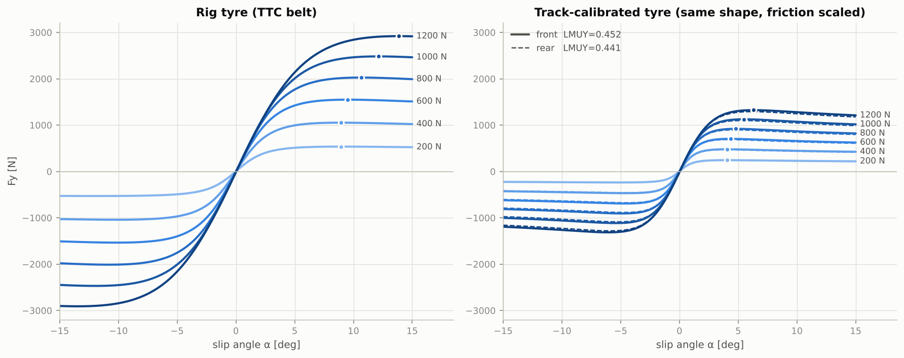
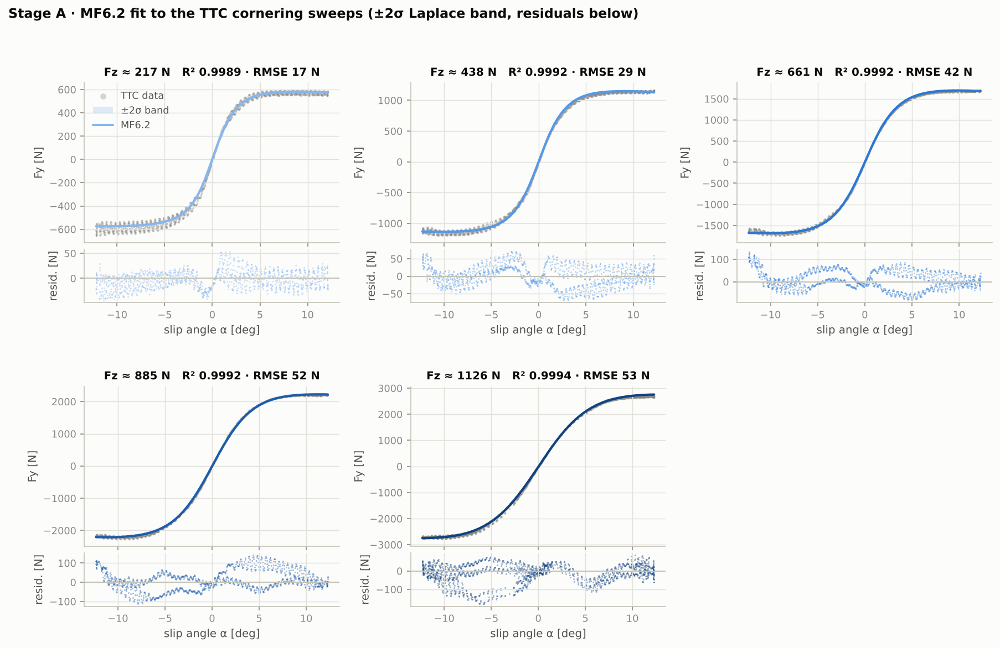
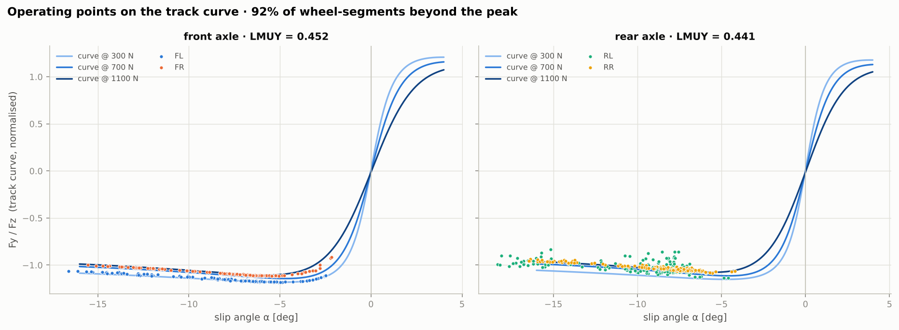
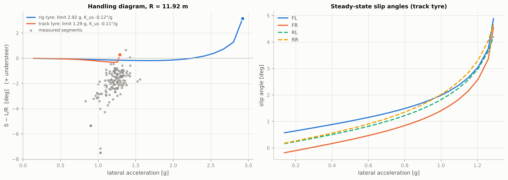
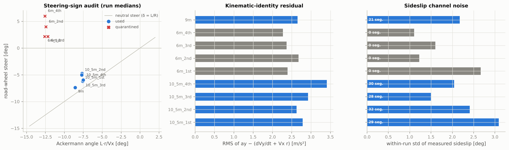
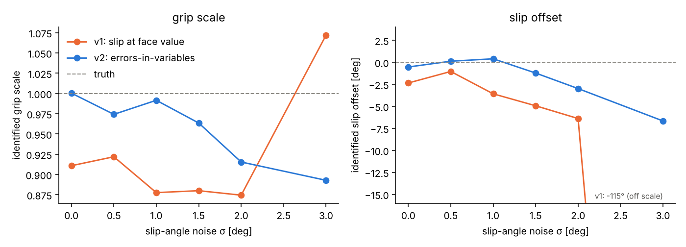
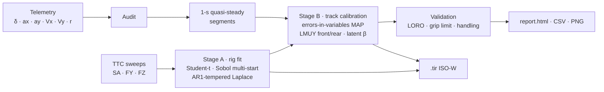
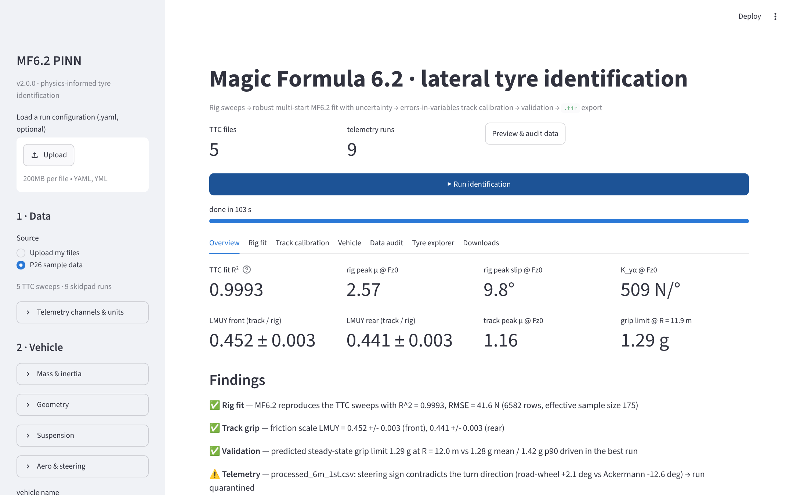

<div align="center">

# MF6.2 PINN

**Physics-informed identification of Magic Formula 6.2 lateral tyre models from Calspan TTC rig data and vehicle telemetry**

[](ci/github-actions-ci.yml)


[](LICENSE)

*Prom Racing · Vehicle Dynamics Department · National Technical University of Athens*



</div>

---

Give it TTC cornering sweeps and (optionally) skidpad telemetry; it returns an
**MF6.2 `.tir` file you can drop into Adams, CarMaker, VI-CarRealTime, MFeval or your
lap-time simulator**, the track-to-rig grip ratio, uncertainties on every number, a
data audit and a self-contained HTML report — from a graphical tool, a CLI or Python.

```bash
pip install -e ".[app]"
mf62pinn app                              # graphical tool in the browser
mf62pinn fit -c configs/p26.yaml          # or the command line  ->  runs/p26/report.html
```

## Highlights

| | |
|---|---|
| 🎯 **Rig fit** | Robust Student-t likelihood, Sobol multi-start + L-BFGS, smooth constrained MF6.2 (no clamps). **R² 0.9993, RMSE 41.6 N** on the five Hoosier 43075 sweeps. |
| 📏 **Uncertainty** | Exact-Hessian Laplace posterior, de-biased for 100 Hz serial correlation (AR(1) inflation), propagated to B, C, D, E, K<sub>yα</sub>, μ<sub>peak</sub>, α<sub>peak</sub> and whole curves. |
| 🏁 **Track calibration** | Hierarchical **errors-in-variables** model: latent sideslip per segment with global/run/segment sensor priors, MF-native `LMUY` per axle, friction-ellipse de-rating. |
| ✅ **Validation** | Leave-one-run-out, steady-state grip-limit solver and handling diagram. Predicted limit **1.29 g** vs **1.28 g** driven on the best runs. |
| 🔎 **Data audit** | Steering-sign check, kinematic-identity check, free-rolling guard against combined-slip files, identifiability report (what the data can and cannot pin down). |
| 📦 **Outputs** | ISO-W `.tir` (rig, track-front, track-rear) verified against an independent MF6.2 evaluator, HTML report, 12 figures, CSV/JSON tables. |
| 🖥️ **Tool** | Streamlit app (upload → run → download), `mf62pinn` CLI, Python API, Windows launchers, YAML configs, 22 tests, CI. |

## Results on the P26 data

<table>
<tr><th></th><th>v1 (<code>legacy/main.py</code>)</th><th>v2 (this package)</th></tr>
<tr><td>TTC fit</td><td>R² 0.9964 · RMSE 94.9 N<sup>1</sup></td><td><b>R² 0.9993 · RMSE 41.6 N</b></td></tr>
<tr><td>Coefficient uncertainty</td><td>none (CI columns = 0)</td><td>Laplace ±σ, AR(1)-corrected (N<sub>eff</sub> = 175 of 6 582)</td></tr>
<tr><td>Hard constraints hit</td><td>C<sub>y</sub> clamp 1.60, grip scale on its 0.5 floor, offset on its +2.5 m/s wall</td><td>none – every coefficient interior</td></tr>
<tr><td>Track grip</td><td>whole-force scale 0.50 / 0.50 (floor)</td><td><b>LMUY 0.452 ± 0.003 / 0.441 ± 0.003</b> (friction only), leave-one-run-out 0.434–0.471</td></tr>
<tr><td>Track peak μ at F<sub>z0</sub></td><td>–</td><td>1.16 (front) / 1.13 (rear)</td></tr>
<tr><td>Sideslip sensor</td><td>one offset, +2.50 m/s, on its bound</td><td>global +3.1° and per-run corrections ±σ, flagged as nuisance</td></tr>
<tr><td>Grip-limit check</td><td>–</td><td>1.29 g predicted vs 1.28 g driven (R ≈ 12 m)</td></tr>
<tr><td>Mis-signed 6 m steering runs</td><td>used</td><td>detected and quarantined</td></tr>
<tr><td>Steer yaw-moment sign / SAE→internal map</td><td>inconsistent (report §6.5, §2.1)</td><td>one geometry definition, exact sign map</td></tr>
<tr><td>Deliverable</td><td>coefficients JSON + PNGs</td><td><code>.tir</code> ×3, HTML report, tables, GUI</td></tr>
</table>

<sup>1</sup> v1 re-run today on the same files with its default settings; the report's reference run gives R² 0.994, RMSE 106 N.

**What the telemetry does and does not identify.** 92 % of the quasi-steady
segments sit beyond the tyre peak: the car was driven at its grip limit. The
telemetry therefore fixes the friction level (`LMUY`, and the 1.29 g limit) but
not the on-track slip angles or cornering stiffness, which remain
prior-dominated — the tool says so in the report instead of returning an artefact.
This is the conclusion of the v1 audit (report §8.1), now produced automatically and
quantified. See [docs/methodology.md](docs/methodology.md) §6 for what data would change it.

<p align="center"></p>

<details>
<summary><b>More figures</b> – operating points, handling diagram, data audit</summary>

<p align="center"></p>
<p align="center"></p>
<p align="center"></p>
<p align="center"><br><i>Errors-in-variables twin (<code>examples/synthetic_eiv_twin.py</code>): taking a noisy slip angle at face value drives the fit onto the plateau; the latent-slip formulation stays close to the truth.</i></p>
</details>

## How it works



**Physics (kept from v1, made consistent).** MF6.2 pure-lateral force with scaling
factors; the team's MATLAB `LoadTransfer_v2` (static, longitudinal, Milliken lateral,
roll-dependent aero); rigid-body slip kinematics; steady-state lateral and yaw balances.
One wheel-geometry definition feeds all three blocks.

**Stage A – rig.** Friction-space residuals, equal weight per load, Student-t
likelihood with learned scale, weakly-informative physical priors, sigmoid-bounded
coefficients, camber terms auto-frozen when there is no camber. Batched Sobol
multi-start → L-BFGS. Laplace covariance from the exact Hessian, tempered by the
AR(1) variance-inflation factor of the residuals.

**Stage B – track.** v1 put the noisy kinematic slip angle straight into the
balances; least squares then hides every wheel on the post-peak plateau
(regression dilution, report §6). v2 fits 1-s segment means, gives each segment a
latent sideslip `β = β_meas + b_global + b_run + e_seg` with sensor-accuracy
priors, scales the rig curve with MF6.2's `LMUY` per axle (friction only) and
optionally `LKY`, and reports every competing basin. Full details:
[docs/methodology.md](docs/methodology.md).

## Installation

```bash
git clone <this repo> mf62-pinn && cd mf62-pinn
python -m venv .venv && .venv\Scripts\activate      # Windows  (source .venv/bin/activate elsewhere)
pip install -e ".[app]"                              # add ,dev for tests
```

On Windows you can also double-click **`install.bat`**, then **`launch_app.bat`**.

## Usage

<details open>
<summary><b>Graphical tool</b></summary>

```bash
mf62pinn app
```
Upload TTC files (`.csv`/`.dat`/`.mat`) and telemetry, set vehicle parameters, press
**Run identification**, explore the tyre interactively and download the `.tir` files,
the report or everything as a zip.

<p align="center"></p>
</details>

<details>
<summary><b>Command line</b></summary>

```bash
mf62pinn fit -c configs/p26.yaml                         # full run
mf62pinn fit --ttc "my_ttc/*.dat" --no-track --quick      # rig only, ~20 s
mf62pinn fit -c configs/p26.yaml --set track_fit.per_axle=false validation.leave_one_run_out=false
mf62pinn audit -c configs/p26.yaml                       # data checks only
mf62pinn predict --tir runs/p26/tyre_track_front.tir --fz 300,700,1100
mf62pinn init my_car.yaml                                # template with every option
```
</details>

<details>
<summary><b>Python</b></summary>

```python
from mf62pinn import RunConfig, run_pipeline

res = run_pipeline(RunConfig.from_yaml("configs/p26.yaml"))
res.headline                 # key numbers
res.ttc_fit.values, res.ttc_fit.std
res.track.lambdas            # {'LMUY_front': 0.452, 'LMUY_rear': 0.441, 'LKY': 1.0}
res.handling_track["curve"]  # steady-state handling diagram
```
</details>

## Inputs and outputs

* **Inputs** – TTC cornering sweeps (SA, FY, FZ; IA, FX, P, V optional) and, optionally,
  telemetry with time, steering, ax, ay, Vx, Vy, yaw rate. Column names and units are
  configurable. → [docs/data_format.md](docs/data_format.md)
* **Outputs** – `report.html`, `tyre_rig_TTC.tir`, `tyre_track_front.tir`,
  `tyre_track_rear.tir`, coefficient and characteristic tables with ±σ, per-segment and
  per-sample reconstructions, validation tables, figures, `metrics.json`,
  `config_used.yaml`. → [docs/user_guide.md](docs/user_guide.md#5-outputs)

## Repository layout

```
├── src/mf62pinn/
│   ├── config.py            every tunable, YAML round-trip
│   ├── vehicle.py           geometry, LoadTransfer_v2, slip kinematics, balances
│   ├── tyre.py              differentiable MF6.2 lateral, constrained parameters, characteristics
│   ├── data/                readers (csv/dat/mat), TTC loader + guard, telemetry audit + segmentation
│   ├── fit/                 stage A (ttc.py), stage B (track.py), likelihoods/Laplace (common.py)
│   ├── analysis/            characteristic values ±σ, steady-state handling solver
│   ├── export/tir.py        ISO-W .tir writer/reader + independent MF6.2 evaluator
│   ├── viz/, report.py      figures and the HTML report
│   ├── pipeline.py          end-to-end orchestration
│   ├── cli.py               `mf62pinn` command
│   └── app/streamlit_app.py graphical tool
├── ci/                      GitHub Actions workflow (move to .github/workflows/ci.yml when you push)
├── configs/                 p26.yaml · ttc_only.yaml · v1_compat.yaml
├── data/                    TTC sweeps and P26 telemetry (see data/README.md)
├── docs/                    methodology, user guide, data format, v1 report (PDF)
├── examples/                quickstart.py · synthetic_eiv_twin.py
├── legacy/                  v1 main.py and validate_numerics.py
├── results/                 p26_v2 (current) · reference_v1
└── tests/                   22 tests: physics, sign conventions, .tir round-trip, recovery, end-to-end
```

## Testing

```bash
pip install -e ".[dev]"
pytest -m "not slow"      # 21 unit tests, ~3 s
pytest                    # + end-to-end run on the bundled data
```

The suite checks, among others: slope at the origin = K<sub>yα</sub> (autograd),
Newton peak = dense-grid peak, LMUY preserves stiffness, frozen parameters get no
gradient, load-transfer moment balance, yaw-moment geometry, `.tir` ↔ model agreement
to < 0.05 N with ISO-W signs, recovery of a known tyre from synthetic SAE data, and
detection of a drive/brake file supplied as a cornering sweep.

## Documentation

* [Methodology](docs/methodology.md) – equations, estimator, diagnostics, what the data support
* [User guide](docs/user_guide.md) – GUI, CLI, Python API, outputs, adapting to another car
* [Data format](docs/data_format.md) – required channels, units, sign conventions
* [v1 report (PDF)](docs/PINN_Lateral_MF62_Identification.pdf) – the audit that motivated v2
* [Changelog](CHANGELOG.md)

## Citation

```bibtex
@software{fragos_manika_mf62pinn_2026,
  author  = {Fragos, Theodore and Manika, Andriana},
  title   = {MF6.2 PINN: physics-informed identification of Magic Formula 6.2 lateral tyre models},
  year    = {2026},
  version = {2.0.0},
  note    = {Prom Racing, National Technical University of Athens}
}
```

## License

Code: [MIT](LICENSE). The Calspan TTC data are licensed to TTC members and are not
covered by this license — keep `data/TTC data/` out of public repositories.

## Acknowledgments

The Prom Racing team and its Vehicle Dynamics Department. Tyre data: Calspan Tire
Test Consortium (FSAE TTC).
